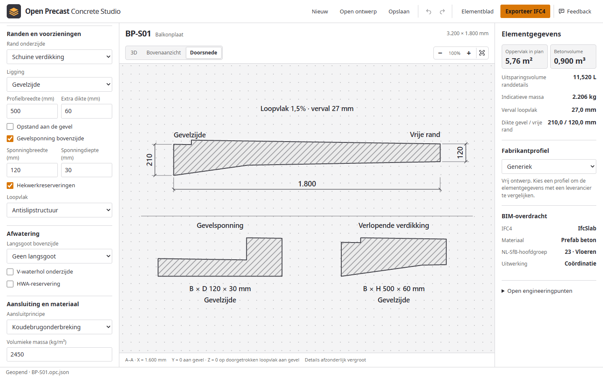

# Open Precast Concrete Studio

Met Open Precast Concrete Studio teken je prefab balkon- en galerijplaten, maak je een elementblad en exporteer je het betonlichaam naar IFC4.



## Installeren op Windows

Download het bestand met de uitgang `windows-x64-setup.exe` en voer het uit. De installer installeert de app voor je eigen Windows-account. Open daarna **Open Precast Concrete Studio** vanuit Start. Tekenen en exporteren werken lokaal. [Download de nieuwste release](https://github.com/OpenAEC-Foundation/open-precast-concrete-studio/releases/latest)

**Opslaan** opent een Windows-dialoog voor het bewerkbare `.opc.json`-ontwerp. Met **Exporteer IFC4** kies je waar het `.ifc`-bestand komt. **Elementblad** bewaart de tekening als liggende A4-PDF. **Open ontwerp** opent een eerder opgeslagen plaat.

De installer gebruikt Microsoft Edge WebView2. Als deze runtime op de computer ontbreekt, downloadt de installer deze bij de eerste installatie.

De ZIP op dezelfde releasepagina bevat de webversie en voorbeelden. Pak de ZIP uit en open `index.html` in Edge of Chrome. De voorbeelden kun je ook openen in de Windows-app. [Galerijplaat met afwatering](examples/GP-A01.opc.json) · [Balkon met gemeten randprofiel](examples/BP-P01.opc.json) · [Galerijplaat met opstand](examples/GP-Z01.opc.json)

## Een plaat tekenen

Met **Nieuw** kies je uit vier startmodellen. De rechte balkonplaat, de galerij met afwatering, het balkon met gevelsponning en het gemeten Hi-Con-profiel hebben elk een voorbeeld van hun doorsnede. Geef het nieuwe element een merk en een bouwlaag. Lengte loopt evenwijdig aan de gevel, diepte vanaf de gevel naar de vrije rand. Het doorgetrokken loopvlak ligt aan de gevel op lokaal peil nul.

Bij **Lineair dikteverloop** stel je de verticale plaatdikte in aan de gevel en aan de vrije rand. Het afschot bepaalt de bovenzijde. De dikten bepalen de onderzijde. Een rechthoekige of schuine verdikking kan aan de gevel of aan de vrije rand liggen. De opstand en randverdikking tellen beide mee in het volume binnen de gekozen plattegrond.

Bij **Hi-Con · gemeten doorsnede** volgt de editor een vaste snede van 2.210 mm diep door het betonlichaam van het onderzochte balkon. De gevelneus en het waterhol bepalen mede de plaatselijke dikte. Het loopvlak heeft 1% afschot. Bij een rechthoekige lengte van 2.200 mm levert de over die lengte doorgetrokken snede 0,425991962 m³ beton op. Het fabrikantmodel bevat daarnaast plaatselijke geometrie en afzonderlijke onderdelen. [Meting en bron](docs/bim-referentie.md)

De drie tekenweergaven gebruiken hetzelfde elementmodel. Zoom met het muiswiel rond de aanwijzer of met **+** en **−**. In 3D draai je de plaat door te slepen en verschuif je haar met Shift en slepen. In bovenaanzicht en doorsnede kun je direct slepen. **Passend in beeld** brengt de hele tekening terug. Het elementblad bevat het bovenaanzicht, de doorsnede, maatvoering in millimeters, reserveringen en hoeveelheden. In de webeditor opent **Elementblad** het afdrukvenster.

Met **Ongedaan maken** en **Opnieuw** kun je veldwijzigingen in de huidige plaat terugdraaien en herstellen. Begin je een ander element, dan start voor dat element een nieuwe bewerkingsgeschiedenis. Eerdere platen zijn terug te vinden bij **Werkversies**.

### Gevelsponning tekenen

Schakel **Gevelsponning bovenzijde** in en geef de breedte vanaf de gevel en de verticale diepte op. De uitsparing volgt het loopvlak over de hele plaatlengte. Bij BP-S01 neemt de sponning van 120 × 30 mm precies 11,52 liter beton weg. Met de schuine verdikking onder de gevelzijde komt het netto betonvolume op 0,90048 m³. [Bewerkbaar voorbeeld](examples/BP-S01.opc.json) · [Elementblad](examples/BP-S01.pdf) · [IFC4](examples/BP-S01.ifc) · [Vergelijking van de twaalf referentiebeelden](docs/ontwerpreferenties.md)

### Afwatering tekenen

Kies bij **Afwatering** een rechthoekige langsgoot of een V-goot in het loopvlak. Vul de breedte, verticale diepte en afstand van de vrije rand tot de buitenste lip in. Met **V-waterhol onderzijde** teken je op dezelfde manier een afzonderlijke druipgroef. Beide details lopen evenwijdig aan de gevel en eindigen bij de werkelijke plaatcontour. De uitsparingen zijn zichtbaar op het elementblad en in de 3D-geometrie van de IFC. Het elementpaneel toont het uitgespaarde volume in liters en de resterende hoeveelheid beton in m³.

Met **HWA-reservering** plaats je het hart van een toekomstige afvoer op de gootbodem. Zonder langsgoot ligt het punt op de vrije rand. De invoer loopt van 0% links tot 100% rechts op de plaatselijke plaatbreedte. Tekening en IFC geven de coördinaten door. Voor een fysieke doorvoer kies je bij de verdere engineering een afvoerpot en bijbehorende sparingsmaat. Het gemeten Hi-Con-profiel bevat zijn eigen waterhol.

De editor vergelijkt de hoogte van de buitenlip van de goot met die van de HWA-reservering. Bij een V-goot van 300 mm breed en 2 mm diep op een loopvlak met 2% afschot ligt de buitenlip 1 mm lager dan de HWA. Dit hoogteverschil verschijnt bij de elementgegevens en op het elementblad. Je kunt het ontwerp verder bewerken en exporteren.

Voorbeeld GP-A01 is een galerijplaat van 3.600 × 1.800 mm met een langsgoot van 120 × 20 mm en een waterhol van 16 × 8 mm. De twee uitsparingen nemen samen 8,8704 liter beton weg. Het netto volume is 1,0765296 m³. [Elementblad](examples/GP-A01.pdf) · [IFC4](examples/GP-A01.ifc) · [Fabrikantdetails en metingen aan 3D-bestanden](docs/afwatering.md)

## Fabrikantprofielen en BIM

- **Generiek** bewaart het element zonder leverancierselectie.
- **Olbecon** vergelijkt balkonlengte, diepte en berekende massa met respectievelijk 10.000 mm, 3.000 mm en 17.000 kg. Een overschrijding blijft zichtbaar en het ontwerp blijft bewerkbaar. De bron noemt deze waarden specifiek voor balkons. [Olbecon](https://www.olbecon.nl/prefab/balkons-en-galerijplaten)
- **Vebo** vergelijkt het afschot met het vlakke loopvlak van het standaardbalkon en benoemt de uit te werken ringgoot en randdetails. Het is een referentieprofiel. [Vebo standaardbalkon en Revit-tool](https://www.vebo.nl/balkonconcept)
- **OMG Prefabbeton** vergelijkt zowel balkons als galerijen met de algemene productiematen van het atelier (10.000 × 4.500 mm en 16.000 kg). Voor de uitvoering met klokput laat de app zien of de goot en HWA-positie zijn ingetekend. [OMG, producten en productiemogelijkheden](https://www.omgprefabbeton.be/)
- Een daadwerkelijk IFC2X3-fabrikantmodel van **Hi-Con Basic Line** is onderzocht op onder meer plaattype, randgeometrie en de betekenis van oppervlaktes. [Modelvergelijking met meetpunten en bronbestand](docs/bim-referentie.md)
- De Nederlandse informatiekaart voor balkon- en galerijplaten onderbouwt de keuze voor `IfcSlab`, bouwlaag, elementmerk, maatvoering en voorzieningen. [Henselmans, informatiekaart p. 22](https://henselmans.nl/uploads/disk-162-cms/Downloads/BIM/HENSELMANS%20BIM%20Informatiekaarten%20V1.2-compressed.pdf)

**Exporteer IFC4** schrijft één gesloten betonlichaam als `IfcSlab/FLOOR`, in een bouwlaag met de ingevoerde naam. Het bestand bevat materiaal, lokale plaatsing, projectieoppervlak, betonvolume en indicatieve massa. Het peil is lokaal. Na heropenen van het ontwerp of een maatrevisie houdt het element dezelfde IFC-identiteit.

**Werkversies** bij **Element ontwerpen** geeft toegang tot eerdere lokale ontwerpen. Als je een andere plaat opent of met **Nieuw** begint, kun je hier terug naar de vorige tekening. Versie 0.6.0 leest werkversies uit 0.4.1, 0.5.0 en 0.5.1. Door een eigen opslagplek voor nieuwe bewerkingen blijven ze ook na tussentijds gebruik van een oudere versie beschikbaar. Ze zijn gekoppeld aan het lokale app- of browserprofiel.

**Opslaan** bewaart het ontwerp als zelfstandig, bewerkbaar `.opc.json`-bestand in ontwerpformaat 0.5. Bestanden uit ontwerpformaat 0.2, 0.3 en 0.4 behouden hun doorsnede en IFC-identiteit. Concepten uit 0.1 krijgen bij migratie een identiteit.

## Feedback in de app

**Feedback** in de titelbalk opent een Nederlands formulier voor fouten, ideeën en vragen. Zolang registratie bij Open Feedback Studio in behandeling is, kun je de melding via **Concept opslaan** lokaal bewaren als tekstbestand. Na activering van het app-id kan dezelfde dialoog de melding naar de centrale dienst verzenden. [Open Feedback Studio](https://open-feedback-studio.pages.dev)

## Basis uit Open Stair Studio

Overgenomen uit de lokale Open Stair Studio-distributie zijn de OpenAEC Blueprint-ontwerptokens. Bron en licentie staan in `public/blueprint`. Net als in de prefabtrapmodule leidt `build()` uit de gecontroleerde parameters de geometrie en hoeveelheden af. De applicatiecode staat in `src/`, de gedeelde OpenAEC-stijlen in `public/`. De webeditor heeft een eigen plaatmodel, tekenmodule en IFC4-schrijver.

## Controles herhalen

Gebruik op de ontwikkelmachine Node.js, npm, Edge en uv.

```powershell
npm ci
npm run verify
```

De installatie is alleen nodig voor de ontwikkelcontroles. De volledige controle voert de modeltests uit, opent de lokale HTML-pagina in Edge, bedient de editor en controleert de IFC4-bestanden met IfcOpenShell. De onafhankelijke inspectie gebruikt Python 3.12 via uv. Voor geïnstalleerd Chrome in plaats van Edge kun je `OPCS_BROWSER=chrome` instellen.

Voorbeeld GP-Z01 heeft een afgeschuinde hoek van 450 × 450 mm en een opstand van 80 × 140 mm. Oppervlak in plan is 8,17875 m², volume 1,68727 m³ en verval 27 mm. Het meegeleverde IFC-bestand is heropend en nagemeten. De PDF bevat één liggend A4-elementblad.

Voor een onafhankelijke vergelijking met het oorspronkelijke fabrikantbestand, download je het IFC2X3-model uit de onderzoeksnotitie en voer je `npm run test:ifc -- --source-reference "pad/naar/fabrikant.ifc"` uit.

## Repository en distributie

De applicatie gebruikt de AGPL-3.0-licentie. De meegeleverde Blueprint-tokens hebben een eigen bronvermelding en licentie. [Applicatielicentie](LICENSE) · [Blueprint](public/blueprint/NOTICE.txt)

GitHub Actions voert de model-, browser- en IFC-controles uit bij een push naar `main` en bij pull requests. Voor een release bouwt GitHub de Windows x64-installer met Tauri en NSIS. De installatietest start het geïnstalleerde programma, tekent een balkonplaat en controleert het geëxporteerde bestand met IfcOpenShell. Na de geslaagde controles publiceert de releaseworkflow de installer, de webversie als ZIP en `SHA256SUMS.txt`. [Releasenotities](https://github.com/OpenAEC-Foundation/open-precast-concrete-studio/blob/main/.github/release-notes.md)

Lokaal bouw je de installer op Windows met Node.js, Rust voor MSVC, de Visual Studio C++ Build Tools en WebView2. Voer `npm ci` en `npm run desktop:build` uit. De installer verschijnt in `target/release/bundle/nsis/`. De webversie verpak je met `py scripts/package-release.py`.
